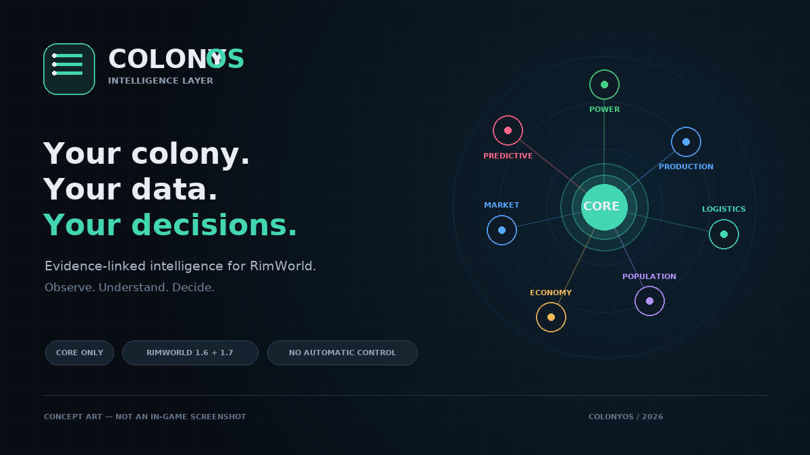

# ColonyOS

**Your colony. Your data. Your decisions.**



*Concept art for presentation only; runtime screenshot capture remains part of the release gate.*

ColonyOS is a RimWorld colony intelligence mod with a custom dark operations dashboard, persistent measurements, seven connected intelligence departments, and evidence-linked forecasts. It observes and recommends; it never takes control of bills, work assignments, storage, or trading.

## Included in this implementation

- **Overview command centre:** eight drill-down KPIs, power and wealth trends, production activity, resource value, workforce, warnings, and regional demand.
- **Power:** generation/consumption, battery reserve and history, network balances, generator contribution, current device output, and depletion estimates.
- **Production:** active bills, current workstation status, ingredient readouts, recorded bill-completion history, and labour coverage.
- **Logistics:** counted resources and locations, human-edible nutrition, stockpile-slot pressure heatmaps, and food/storage trend forecasts.
- **Population:** skill distribution/depth, work allocation, idle observations, and qualified production workers.
- **Economy:** WealthWatcher totals and composition, resource base values, actual purchases/sales, and transaction history.
- **Regional Market:** distinct **Confirmed**, **Historical**, and **Estimated** rankings; merchant profiles, current purchasing eligibility, capacity where exposed, and actual sale prices.
- **Predictive:** severity, timeframe, evidence class, confidence, supporting evidence, department drill-down, and suggested player action.
- Persistent bounded history, four time ranges, three themes, four accent palettes, filters/sorting, tooltips, responsive grids, and configurable thresholds/widgets.

No numbers are inserted to make empty charts look populated. Measurement limitations are shown in the interface and in [`docs/ARCHITECTURE.md`](docs/ARCHITECTURE.md).

## Requirements and installation

- RimWorld **1.6** (primary) or **1.7**
- [Harmony](https://github.com/pardeike/HarmonyRimWorld) (`brrainz.harmony`) loaded before ColonyOS
- **No DLC and no external UI framework**

Place the `ColonyOS` folder in `RimWorld/Mods`, enable Harmony and then ColonyOS, and use the **ColonyOS** main tab. Existing saves are supported through RimWorld's `GameComponent`/`Scribe` lifecycle. As with any mod, back up important saves first.

## Build and verification

Requires the .NET 10 SDK. Reference assemblies are restored from NuGet; a local RimWorld installation is not needed to compile.

```bash
dotnet restore Source/ColonyOS.csproj
dotnet build Source/ColonyOS.csproj -c Release
dotnet run --project Tests/ColonyOS.Analytics.Tests.csproj -c Release
python3 scripts/verify_mod.py
```

Outputs go to `1.6/Assemblies/ColonyOS.dll` (`net472`, Harmony 2) and `1.7/Assemblies/ColonyOS.dll` (`net10.0`, Harmony 3). Do not bundle `0Harmony.dll`; the Harmony mod supplies it.

## Validation status

The repository includes automated dual-target builds, analytical tests, and package checks. **Actual in-game UI, performance, trade interoperability, and save/load testing still requires licensed RimWorld installations.** No in-game screenshot or runtime certification is claimed here. The release checklist is in [`docs/TESTING.md`](docs/TESTING.md), and the framework research decision is in [`docs/RESEARCH.md`](docs/RESEARCH.md).

## License

MIT — see [`LICENSE`](LICENSE). RimWorld and its assemblies are property of Ludeon Studios; they are not bundled.
